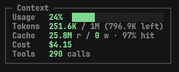
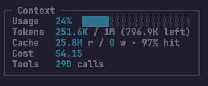

# OpenCode Context Sidebar Plugin

<p align="center">
  
  
</p>

## Overview

This plugin displays real-time resource utilization metrics directly inside the OpenCode terminal interface. It tracks active session token consumption relative to the configured model limits, computes cache efficiency, tallies accumulated financial costs, and counts tool invocations across conversational turns. It is built for developers and operators who need visibility into context consumption and execution cost during agent runs.

## Features

- Real-time context usage progress bar with dynamic threshold coloring based on consumption percentage.
- Token tracking that measures current message exchanges against the active model context window ceiling.
- Cache efficiency metrics showing read hits, write additions, and percentage hit rates.
- Financial cost accounting showing accumulated session expenditure in USD.
- Invocation tallying tracking the number of tool execution steps in the session.
- Responsive layout adaptation adjusting visual metrics and label formats to available sidebar width.
- Native theme integration inheriting colors and styles from OpenCode.

## Overview of Operation

The plugin hooks into the OpenCode TUI slot lifecycle to render a reactive panel within the sidebar:

- Data Ingestion: Subscribes to session message streams, token breakdowns, model limits, and cost calculations provided by OpenCode.
- Metrics Extraction: Aggregates assistant responses, token allocations, tool calls, and cache statistics.
- Terminal Presentation: Renders reactive SolidJS visual components into the terminal sidebar slot.

## Metrics & Data Schema

The sidebar extracts and computes normalized metrics from the active session's message stream and model profile:

| Field | Type | Description |
|---|---|---|
| `total` | `number` | Combined tokens from the latest assistant turn (input, output, reasoning, cache read/write). |
| `limit` | `number?` | Context window ceiling of the active model (`<providerID>:<modelID>`). |
| `percent` | `number?` | Ratio of `total` tokens against `limit`, capped at 100%. |
| `left` | `number?` | Headroom remaining before reaching the model context window limit. |
| `cacheRead` | `number` | Cumulative prompt cache read hits across all session assistant turns. |
| `cacheWrite` | `number` | Cumulative prompt cache write additions across all session assistant turns. |
| `hitRate` | `number?` | Cache efficiency percentage derived from `cacheRead` over total prompt tokens. |
| `cost` | `number` | Accumulated financial session expenditure formatted in USD. |
| `toolCalls` | `number` | Total number of tool invocations performed across the session. |

## Tech Stack

- Runtime: Bun
- Language: TypeScript
- UI Framework: SolidJS (`@opentui/solid`)
- Terminal Graphics: OpenTUI Core (`@opentui/core`)
- Platform SDK: OpenCode Plugin and Client API (`@opencode/plugin`, `@opencode/client`)
- Image and Icon Rasterization: Resvg JS (`@resvg/resvg-js`)

## Prerequisites

- Bun runtime (version 1.0.0 or higher)
- OpenCode V2 environment

## Installation

Clone the repository into the OpenCode plugins directory:

```bash
git clone https://github.com/MomoPi-Dark/opencode-sidebar-modern-context.git ~/.config/opencode/plugins/context
cd ~/.config/opencode/plugins/context
bun install
bun run build
```

## Execution & Scripts

Development and maintenance commands:

```bash
# Run TypeScript typechecking and test suite
bun run check

# Run unit tests
bun run test

# Run TypeScript typechecker
bun run typecheck

# Build and transform JSX/TSX assets
bun run build

# Watch mode for development compilation
bun run dev

# Pull latest changes, verify, and rebuild
bun run update
```

## License

This project is licensed under the MIT License. See the [LICENSE](./LICENSE) file for details.
